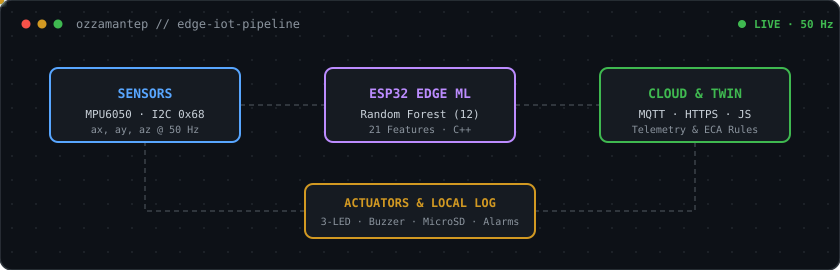

  

# Hi, I'm Muhammad Dzakwan Ikram 👋

**Computer Engineering Student · Embedded Systems · IoT · Edge ML**

I'm a **Computer Engineering student at Universitas Brawijaya (FILKOM UB)** who enjoys building real-world systems at the intersection of **hardware, firmware, and Edge Intelligence** — from sensor acquisition on microcontrollers to digital twin & cloud telemetry.

---

### About Me
- 🎓 Studying **Computer Engineering @ Universitas Brawijaya**
- 🔌 Exploring **Embedded Systems, IoT, and Edge Computing**
- 🤖 Building **Edge Machine Learning** pipelines (training in Python, pure C/C++ inference on **ESP32**)
- 🌐 Developing **Digital Twin** & web-based monitoring systems
- 🛠️ Lab & experimentation at **RESLAB (Robotic and Embedded System Laboratory)**

---

### Tech Stack

---

### Featured Projects *(click to expand)*

<b>🤖 Edge_Tugas_Akhir</b> — Real-time Human Activity Recognition on ESP32

 

- **Model**: Random Forest (`12` trees, `max_depth=6`, **98.99%** test accuracy) exported to pure C++ (`model.h`)
- **Hardware**: ESP32 DevKit V1 + MPU6050 (`50 Hz`), 3-LED Activity Indicators (Red/Yellow/Green), Active Buzzer, MicroSD Logger
- **Cloud**: Non-blocking HTTPS / MQTT telemetry + ECA Alarm Rules
- 🔗 [View Repository](https://github.com/ozzamantep/Edge_Tugas_Akhir)

<b>🌊 digitaltwinamarinefilkomub</b> — Marine Digital Twin Web App

 

- **Stack**: JavaScript-based Digital Twin monitoring & visualization interface
- **Focus**: Real-time state representation & monitoring for marine/aquaculture systems at FILKOM UB
- 🔗 [View Repository](https://github.com/ozzamantep/digitaltwinamarinefilkomub)

---

### Connect
- 📧 Email: `dzakwangans@student.ub.ac.id`
- 🐙 GitHub: [@ozzamantep](https://github.com/ozzamantep)
